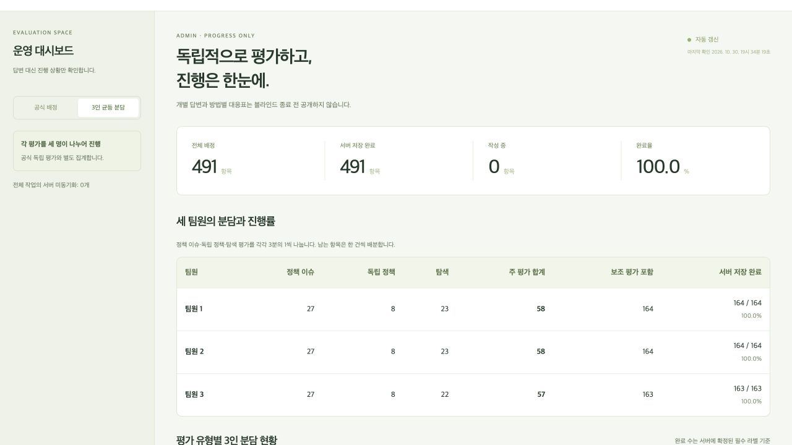

# 온라인 배포 및 실제 Supabase 검증

2026-10-30, Asia/Seoul.

- 웹앱: https://uiseokys.github.io/kisti-policy-review-web/
- 앱 소스: https://github.com/uiseokys/kisti-policy-review-web
- Supabase 프로젝트: `rokntsfyobsvfaqqkwtw`.
- GitHub Actions의 CI와 Pages 배포가 성공했고, 실제 웹 주소 HTTP 200 및 이름·비밀번호 접속 화면을 확인했습니다.
- 최종 로컬 자동화 시험은 **22개 파일, 124/124 통과**이며 TypeScript/Vite 빌드·배포물 비밀키 검사와 합성 CSV 보존 검사도 통과했습니다.
- migration 001/002/003을 새 프로젝트에 설치했습니다. Realtime publication에는 `review_progress`만 포함됩니다. 비공개 초대 관련 세 테이블의 익명 조회는 실제 API에서 모두 401로 차단됐습니다.
- `team-access` Edge Function을 배포했습니다. 브라우저에서 사용하는 공개 키와 서버 관리자 키를 분리하며, 현행 키 사전과 레거시 키를 지원합니다. 자체 초대·비밀번호 검증을 사용하므로 레거시 JWT 게이트웨이 검사는 껐습니다. CORS 사전 응답은 공식 앱 origin에 대해 204를 확인했습니다. CORS 자체를 비브라우저 호출자의 인증 수단으로 간주하지 않습니다.

## 팀원 접속

이메일 계정을 미리 만들지 않습니다. 비공개 참여 링크에서 팀원 자리가 지정되고, 본인이 이름과 비밀번호를 설정하면 자동 접속합니다. 이후에는 자리·이름·비밀번호로 이어서 접속합니다. 관리자는 별도 링크를 사용합니다.

실제 링크는 **이 문서나 저장소에 포함하지 않습니다**. 소유자 기기의 Git 제외 파일 `local-data/participation-links.txt`와 `participation-links.html`에 네 개를 보관했습니다. 각 팀원에게 해당 링크 하나만 개별 전달하고 관리자 링크는 소유자만 사용합니다. 초대는 생성 후 7일간 유효하며 사용된 초대로 다른 계정을 만들 수 없습니다. 초대 파일·SQL·`.env.local`은 권한 0600이며 Git에서 제외되는 것을 확인했습니다.

세 팀원의 주 평가 분담은 58/58/57, 보조 평가 포함 전체 분담은 164/164/163입니다. 미참여 팀원의 계획도 전체 491건 분모에 포함하며 완료 수는 유효하게 저장된 서버 라벨만 반영합니다.

## 실제 서버 시험

`scripts/test-self-service-live.mjs`를 명시적으로 허용해 실행했습니다. 실제 Supabase Auth와 PostgreSQL·Realtime을 사용했으며 대회 원문이나 실제 평가표는 사용하지 않았습니다.

| 검사 | 결과 |
| --- | --- |
| 합성 팀원 3명과 관리자 자체 등록 | 통과 |
| 18개 배정, 164/164/163건, 원천 ID 구간 분리 | 통과 |
| 다른 팀원의 라벨 조회·쓰기 및 관리자 직접 라벨 조회 차단 | 통과 |
| R1/R2 동시 저장, version 충돌, 동일 요청 재전송 | 통과 |
| 불완전 라벨 미완료 처리 및 수정 후 완료율 재계산 | 통과 |
| 기기별 미동기화·충돌 상태와 오래된 보고 차단 | 통과 |
| 관리자 Realtime 진행률 이벤트에 라벨·메모 비포함 | 통과 |
| 새 SDK 세션에서 이름·비밀번호 재접속 후 라벨 복원 | 통과 |
| 합성 491건 DB 저장·재조회 및 18개 세션 제출·잠금 | 통과 |
| 블라인드 종료 전 export 차단 | 통과 |
| 종료 후 491건 내려받기와 R1 81행 CSV 병합·기존 공식 검증기 | 통과 |
| 실제 웹앱 관리자 접속 및 완료율 100% 표시 | 통과 |
| 실제 웹앱 팀원 3 접속, 탭 종료·재개 후 저장 라벨 복원 | 통과 |

최초 검증 시도는 Realtime 추가 검사에서 중단됐습니다. 실패 진단·연결 정리와 재개 절차를 보완해 다시 실행했고 Realtime 및 나머지 모든 서버 시험을 통과했습니다. 최종 시험 상태는 로컬 비공개 상태 파일에 `exported`로 남겼습니다.

자동 저장·IndexedDB 오프라인 큐·복구·충돌 처리의 로컬 행동 시험도 통과했습니다. 실제 웹앱에서 인터넷을 물리적으로 끊는 시험, 브라우저 프로세스 전체 종료, 서로 다른 물리 기기 시험은 수행하지 않았습니다. 새 SDK 세션 시험과 탭 재접속 시험을 물리 기기 검증으로 보고하지 않습니다.

## 실제 팀 공간

검증용 합성 프로젝트와 계정은 분리해 보존했습니다. 해당 프로젝트의 활성 접속 설정만 해제한 뒤 새 팀 공간을 원자적으로 활성화했습니다. 실제 팀원용 공간의 최종 DB 조회는 **합성 분류, 참여 자리 4개, 등록 사용자 0명, 저장 라벨 0건**을 확인했습니다. 검증 결과가 실제 팀원의 작업으로 표시되지 않습니다.

대회 원문·실제 CSV·파생 라벨의 클라우드 이용 허용 여부는 확인되지 않았으므로 **실데이터 동기화와 최종 제출 차단을 유지**합니다. 현재 온라인 검증/평가는 합성 항목에 한정합니다. 실제 CSV는 각 기기의 로컬 초안으로만 가져올 수 있습니다.
