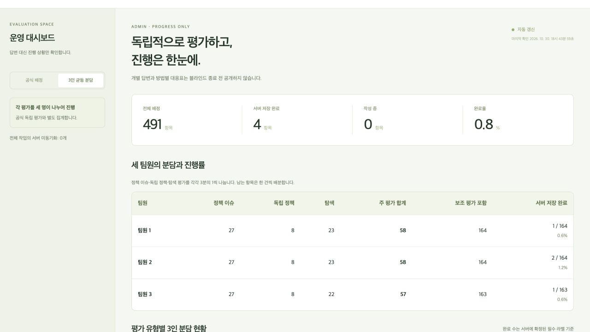
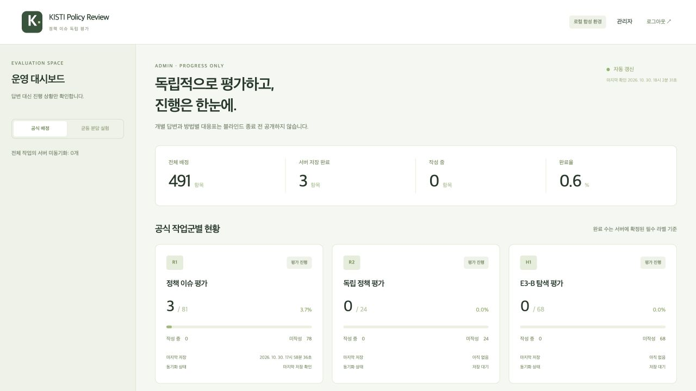

# 검증 범위와 결과

최신 실제 온라인 시험은 [DEPLOYED_STATUS.md](DEPLOYED_STATUS.md)에 기록했습니다. 아래 내용은 Supabase 연결 전의 로컬 개발 기록입니다.

검증일: 2026-10-30, Asia/Seoul. 새 앱의 **합성 데이터만** 사용했습니다. 실제 회의록·정책 평가표를 웹앱, GitHub, Supabase에 올리지 않았습니다. 기존 연구 코드·명세·채점 수식은 수정하지 않았으며 Git commit·push·배포도 수행하지 않았습니다.

## 3인 분담 기능 추가 검증 · 18:43 KST

최신 전체 실행은 **14개 파일, 55/55 통과**입니다. TypeScript strict 검사·Vite production build·배포물 키 검사도 통과했습니다. 앞선 40개 시험에 다음 배정·병합 검증을 추가했습니다.

- R1 27/27/27, R2 8/8/8, H1 23/23/22를 각각 별도 그룹으로 유지합니다. 주 평가 합계는 58/58/57, 보조 평가 포함 전체 합계는 164/164/163입니다.
- 18개 분담의 source-row 범위와 ID를 합치면 각 원본 그룹을 정확히 한 번 포함합니다. 다른 팀원의 항목·배정에 대한 저장과 조회는 차단됩니다.
- 전체 CSV를 가져오면 본인 구간만 선택하며, 원본 셀·ID·순서를 유지합니다. 실데이터 동기화 제한도 유지합니다.
- 합성 491건을 세 계정이 18개 세션에서 완료·잠근 뒤, 블라인드 종료 후 여섯 전체 CSV로 병합하는 시험을 통과했습니다. 누락·중복·미잠금·다른 프로젝트·다른 평가자의 결과는 병합을 거부합니다.
- 합성 브라우저에서 팀원 1·2·3의 분리된 작업 목록과 저장을 확인했습니다. 팀원 2의 독립 정책 평가 저장 후 관리자 화면의 완료 수가 새로고침 없이 3→4, 팀원 2는 1/164→2/164로 갱신되었습니다.
- 독립 최종 코드 검토 범위에서 Critical/Important 잔여 지적은 없었습니다. 실제 Supabase는 여전히 미설정이므로 실제 Auth/RLS/PostgREST/Realtime·물리적 다른 기기 검증은 **NOT RUN**입니다.

아래는 초기 앱 구현 시점의 검증 기록입니다.

## 기능별 상태

| 항목 | 로컬 검증 결과 | 실제 Supabase / 기기 검증 |
| --- | --- | --- |
| 자동 저장 | 750ms debounce, 이동 전 flush, ACK 이후에만 저장 완료, 실패 초안 유지 시험 통과 | 연결 정보가 없어 미실행 |
| 중앙 영속 저장 | 실제 migration을 PGlite PostgreSQL에서 실행해 RPC 저장·재조회·버전 검증 | Supabase 클라우드 저장·재조회 미실행 |
| 진행률 | 서버 검증 로직으로 완전/작성 중/미작성 계산, 수정 시 완료 수 감소 시험 통과 | 클라우드 집계 미실행 |
| 관리자 자동 갱신 | 별도 관리자 브라우저 탭이 새로고침 없이 2→3건으로 갱신됨 | Supabase Realtime 이벤트 미실행 |
| 새로고침 복구 | 브라우저에서 저장된 판정·메모·버전 복구 확인 | 실제 Auth 세션 재로그인 미실행 |
| 오프라인 복구 | 연습 오프라인 상태에서 미동기화 초안 작성→새로고침 복구→온라인 전환 후 pending 0 확인 | 실제 인터넷 단절·복원 시험 미실행 |
| 다른 기기 복구 | 새 클라이언트가 서버 라벨을 조회하는 연결 코드와 통합 러너 작성 | 물리적으로 다른 기기 시험 미실행 |
| 동시 편집 | 버전 충돌·명시적 해결·저장 중 추가 편집 보존 자동 시험 통과 | 실제 두 기기의 충돌 UI 시험 미실행 |
| 같은 브라우저 여러 탭 | 두 번째 R1 탭 편집 차단, 첫 번째 탭 종료 후 자동 재개를 브라우저에서 확인 | 서로 다른 브라우저는 DB version으로 보호; 실기기 미실행 |
| 접근 제어 | 로컬 SQL 엔진에서 평가자 간 읽기/쓰기 차단, 관리자 원시 라벨 조회 차단, 제출·블라인드 종료 게이트 시험 | 실제 Supabase Auth/RLS 조합 미실행 |
| 최종 CSV | 합성 원본의 행·헤더·ID·원문 셀 보존 및 잘못된 변경 거부 확인 | 실제 원본 데이터는 사용하지 않음 |

로컬 연습 백엔드는 localStorage를 사용합니다. 이 결과를 Supabase 중앙 저장이나 물리적 다른 기기 복구의 성공으로 해석하지 않습니다. 브라우저의 “오프라인 연습”은 전송을 중지하는 기능 시험이며 실제 통신망 차단의 증명은 아닙니다.

## 자동화 시험

- `pnpm test`: **10개 파일, 40/40 통과**. 도메인 조건부 필드, 원본 CSV 보존, durable outbox, 중복 요청·버전 충돌·재시도, SQL RLS·집계·제출 잠금·안전한 publication, UI 이동·새로고침 복구, Web Locks를 검사했습니다. 합성 공식 배정 491건 전체의 저장·6개 세션 잠금·블라인드 종료 후 CSV 병합도 포함합니다.
- `pnpm build`: **통과**. TypeScript strict 검사와 Vite production build. GitHub Pages 하위 경로 `/kisti-policy-review-web/`를 적용한 별도 빌드도 통과했습니다.
- `pnpm check:secrets`: **통과**. 프런트 소스·배포물·워크플로의 secret/service_role 키 패턴을 검사했습니다. 이 패턴 검사는 모든 민감정보를 탐지하는 일반 보안 감사는 아닙니다.
- `pnpm test:export`: 합성 CSV에 대한 10개 보존/거부 검사. 이 Mac에서 기존 공식 검증기를 수정 없이 5종 모두 실행해 5/5 통과했습니다. CI에 연구 저장소가 없으면 공식 검증기 부분만 미실행으로 표시합니다.
- `pnpm test:supabase`: 설정이 없으므로 **SKIP / NOT RUN**. 실제 DB 시험 통과로 세지 않습니다.

SQL 시험의 Auth schema와 JWT claim은 로컬 service boundary입니다. PGlite가 실제 PostgreSQL SQL을 실행하더라도 Supabase Auth·PostgREST·Realtime 서비스는 실행하지 않습니다. UI 자동 시험은 실제 폼·동기화 엔진·IndexedDB를 사용하고 Web Locks 브라우저 경계만 대체합니다.

최종 전체 시험 실행: 2026-10-30 18:04 KST. 프런트·SQL 수정 후 수행했으며 이후에는 문서와 별도 Pages 빌드 확인만 추가했습니다. 독립 최종 코드 검토에서 검토 범위 내 Critical/Important 잔여 지적은 없었습니다. 실제 원격 환경까지 안전성을 보증하는 결과는 아닙니다.

## 검토 후 보완

독립 코드 검토에서 발견한 문제를 보완했습니다.

- schema 전체를 공개하는 Realtime publication을 허용하지 않고 진행률 요약 테이블만 포함하는지 검사합니다.
- 제출 확인 중 입력을 막고 제출 전 큐·서버 필수 라벨을 다시 확인합니다.
- 같은 브라우저의 작업별 편집자·outbox를 Web Locks 하나로 보호하고 로컬 영속 기록이 끝난 후 잠금을 해제합니다.
- 작업 이동·모드 변경·로그아웃 전 저장을 시도하고, 다른 작업의 미전송 큐는 로그인·온라인 복귀 후 복구합니다.
- 잠금이 잠시 점유된 경우 대기 후 자동 재시도하여 영구 대기 화면에 남지 않게 했습니다.
- 영구 저장 오류는 명시적 재시도와 로컬 초안 다운로드를 제공합니다.
- 기기·배정별 동기화 보고 번호를 전송 전에 로컬에 영속 기록하고, 서버가 오래된 번호를 무시합니다. 지연된 “저장 완료” 보고가 최신 “미동기화/충돌” 상태를 지우지 못합니다.

## 연결 후 수행할 실제 시험

[SUPABASE.md](SUPABASE.md)의 설정 후 일회용 합성 프로젝트에서 `pnpm test:supabase`를 실행합니다. 이 러너는 실제 Auth 사용자 4명, R1/R2 동시 저장과 격리, H1 새 SDK 로그인 복구, DB 저장·재조회, 안전한 Realtime 이벤트, CAS, 제출 잠금과 합성 CSV 검증을 확인합니다. SDK 재로그인은 브라우저 종료나 물리적 기기 시험을 대신하지 않습니다.

이어서 별도 브라우저/기기에서 다음을 확인해야 합니다.

1. R1 저장을 다른 기기 로그인 후 복원하고 관리자 창의 Realtime 갱신을 확인합니다.
2. H1 브라우저 종료 후 다시 로그인하여 저장된 판정과 메모를 확인합니다.
3. 실제 네트워크를 끊고 초안을 작성한 뒤 복원·자동 재전송을 확인합니다.
4. 두 기기가 같은 항목을 수정하여 충돌 UI에서 값을 선택·병합하고, 미전송 기기의 상태가 다른 기기의 저장으로 지워지지 않는지 확인합니다.
5. 합성 공식 배정의 모든 항목을 완료해 제출 잠금, 블라인드 종료, 관리자 로컬 CSV 병합과 공식 검증기를 확인합니다.

실데이터 클라우드 이용은 위 합성 시험과 별개입니다. 원문·파생 라벨 저장 허용 범위를 확인한 뒤 별도 검토와 명시적인 설정 변경이 있어야 합니다. 현재 앱에는 실데이터 동기화를 켜는 스위치가 없습니다.
